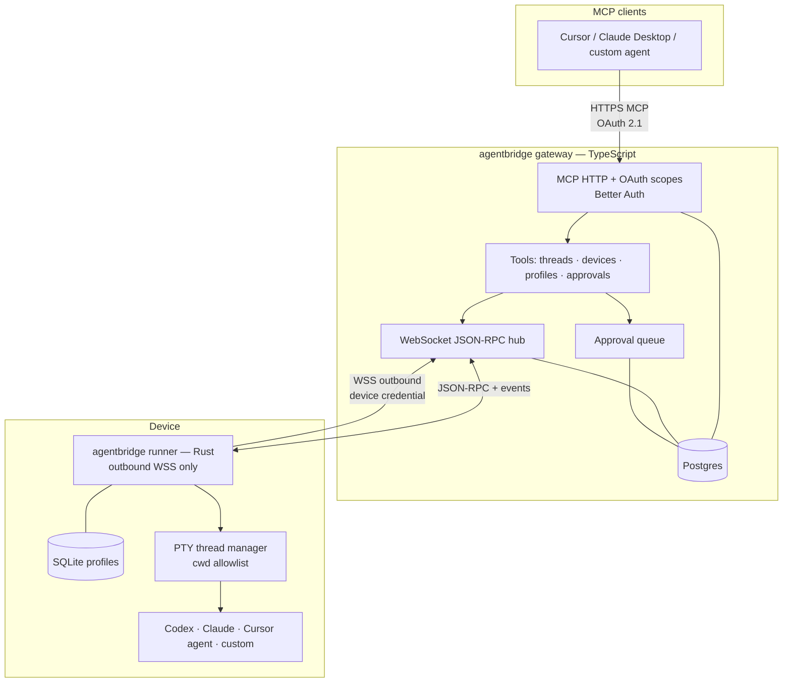
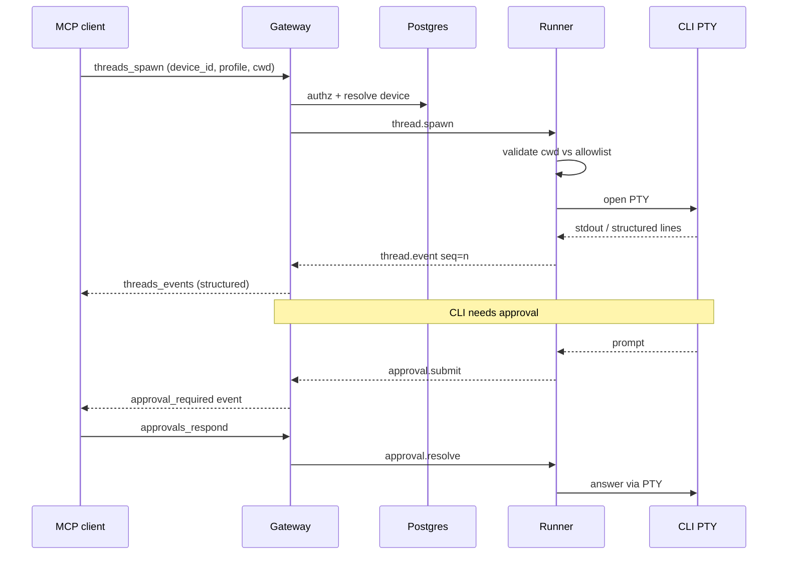
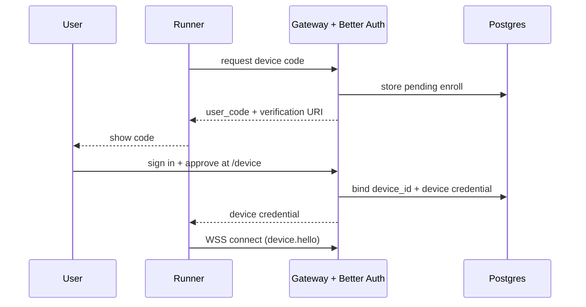

# agentbridge — Architecture & Decisions

This document is the source of truth for product and technical decisions for **agentbridge**: a bridge that lets MCP clients (coding agents and IDEs) remotely control long-lived CLI “threads” on user devices through a relay gateway.

Project name: **agentbridge**.

---

## 1. Product intent

**agentbridge** is a coding-agent bridge for agents:

1. An **MCP client** (Cursor, Claude Desktop, another orchestrator) calls tools on the **agentbridge gateway**.
2. The gateway authenticates the caller, routes work to a registered **device**, and speaks **WebSocket + JSON-RPC** to a **Rust runner** on that device.
3. The runner spawns **PTY-backed** processes for configured CLIs (Codex, Claude Code, Cursor agent, or custom profiles) and streams events back.
4. Other agents do not need to know argv details of each CLI—they use **thread IDs**, **profiles**, and a **normalized event stream**.

This is **not** an IDE remote-SSH product (Cursor Remote). It is closer in spirit to **T3 Code’s environment server** and **Codex’s outbound exec-server + rendezvous**, but neutral: any CLI profile, your gateway, cloud or self-hosted.

---

## 2. High-level topology



**Spawn & event path**



**Device enroll (device code)**



**Production rule:** clients never talk to the runner directly. All control plane traffic goes through the **relay/gateway** for auth, routing, and audit.

---

## 3. Components

| Component           | Language                  | Role                                                              |
| ------------------- | ------------------------- | ----------------------------------------------------------------- |
| **Gateway / relay** | TypeScript                | Auth gateway, MCP server, WS hub, approval queue, device registry |
| **Runner**          | Rust                      | PTY processes, profiles DB, path policy, device-side execution    |
| **Protocol**        | Shared JSON Schema / docs | JSON-RPC methods + event types between gateway ↔ runner           |
| **MCP surface**     | TypeScript (on gateway)   | Tools for threads, devices, profiles, approvals                   |

---

## 4. Decision log (locked)

### 4.1 Connectivity

| Decision                            | Choice                                                                       |
| ----------------------------------- | ---------------------------------------------------------------------------- |
| Reach device                        | **Always via gateway/relay**                                                 |
| Direct runner URL in prod           | **No** (security / NAT / consistent auth)                                    |
| Runner network posture              | **Outbound WSS only** (no inbound ports required on device)                  |
| Control protocol (gateway ↔ runner) | **WebSocket + JSON-RPC** (bidirectional, streaming notifications, reconnect) |

Reconnect: gateway may drop; **runner keeps threads alive**. Thread lifetime is **not** tied to MCP client disconnect. After reconnect, gateway re-attaches to the same device connection and resumes event streaming from a sequence cursor.

### 4.2 Multi-tenancy & deployment

| Decision            | Choice                                                                                |
| ------------------- | ------------------------------------------------------------------------------------- |
| Cloud gateway       | Multi-tenant (users/orgs share a hosted deployment)                                   |
| Self-hosted gateway | **Same product and feature set** as cloud (not a stripped single-tenant fork)         |
| Packaging           | **One Docker image** for the TS gateway; run the same image in cloud or on your infra |
| Database (gateway)  | **Postgres** (required for Better Auth, devices, approvals, audit)                    |
| Database (runner)   | **SQLite** (profiles and local runner state)                                          |

Self-host compose typically: `agentbridge` container + **Postgres** (and optional OTEL collector). Prefer Postgres as a sibling service even when the app is “one image”; do not put production multi-user auth in SQLite on the gateway.

### 4.3 Stack split

| Piece                                | Stack                                                            |
| ------------------------------------ | ---------------------------------------------------------------- |
| Gateway (auth, MCP, routing, WS hub) | TypeScript + Better Auth + MCP SDK                               |
| Runner                               | Rust (static binary)                                             |
| MCP auth                             | `@better-auth/mcp` (+ JWT, CIMD as required by MCP 2026 profile) |

### 4.4 CLI execution model

| Decision                | Choice                                                                        |
| ----------------------- | ----------------------------------------------------------------------------- |
| Subprocess mode         | **PTY** for agent CLIs                                                        |
| Codex / Claude / Cursor | Spawn as **standard PTY processes** (not OpenAI `exec-server` protocol in v1) |
| Profiles                | User-configurable; stored in **runner SQLite**                                |
| First-class adapters    | Codex, Claude Code, Cursor agent (+ generic PTY fallback)                     |

Adapters may parse stream-json / structured lines into normalized events; raw PTY remains available for debug.

### 4.5 Thread lifecycle

| Decision              | Choice                                                            |
| --------------------- | ----------------------------------------------------------------- |
| MCP client disconnect | **Threads keep running** until exit, explicit kill, or policy     |
| Thread identity       | Canonical `thread_id` **(UUID)**                                  |
| Display name          | Optional `name`; **duplicates allowed**; UUID is always canonical |
| History / list        | Filter/list by name helper; identity remains UUID                 |

### 4.6 Device identity & routing

| Decision             | Choice                                                                                                                                   |
| -------------------- | ---------------------------------------------------------------------------------------------------------------------------------------- |
| Canonical device key | `device_id` **(UUID)**                                                                                                                   |
| Human label          | `device_name` (display name) **attached to** that UUID                                                                                   |
| MCP exposure         | Tools accept `device_id`; responses and listings always include `device_id` **+** `device_name` so models can choose the right machine   |
| Resolution           | Optional helper: resolve `device_name` → `device_id` when unique in the user’s/org’s device set; on ambiguity, return error + candidates |
| Default device       | User/org may set a **default** `device_id`; mutating tools omit `device_id` only if a default is set                                     |

### 4.7 Profiles (MCP-first, device-authoritative)

| Decision            | Choice                                                                                                |
| ------------------- | ----------------------------------------------------------------------------------------------------- |
| Source of truth     | **Runner SQLite (per device)**                                                                        |
| How users configure | MCP tools (`profiles_list`, `profiles_upsert`, …) **forwarded to the target device**                  |
| File export         | Optional import/export later; not the primary edit path                                               |
| Secrets             | Env **values** stay on the device; MCP may set **env var names** / references, not relay-held secrets |

**Why device-authoritative:** CLI install paths and OS differ per machine. Relay stores device registry + auth, not profile command templates (except ephemeral cache for UI if needed).

### 4.8 Workspace / cwd

| Decision        | Choice                                       |
| --------------- | -------------------------------------------- |
| Spawn parameter | Absolute `cwd` on the device                 |
| Security        | **Allowlisted roots** on the runner (see §6) |

### 4.9 Approvals

| Decision                                | Choice                                                                                               |
| --------------------------------------- | ---------------------------------------------------------------------------------------------------- |
| Mid-run CLI prompts (run command, etc.) | Surface as `approval_required` **events**; queue on gateway                                          |
| Response path                           | MCP tool `approvals_respond` (approve / deny + optional note)                                        |
| Timeout                                 | **Fail closed**: default **15 minutes** → deny + `approval_timeout` event; thread unblocks as denied |
| Overrides                               | Soft: per-profile timeout / policy later; default remains fail-closed                                |

### 4.10 Limits

| Decision        | Choice                                                                                         |
| --------------- | ---------------------------------------------------------------------------------------------- |
| Resource limits | **Soft defaults** (max concurrent threads, max buffered output, idle hints)                    |
| Overrides       | Per-profile / MCP-configurable within soft bounds; document hard ceilings only if needed later |

### 4.11 Output contract (MCP)

| Decision | Choice                                                                                           |
| -------- | ------------------------------------------------------------------------------------------------ |
| Default  | **Normalized structured events** (`assistant`, `tool`, `stderr`, `exit`, `approval_required`, …) |
| Raw PTY  | Available via `include_raw: true` (or equivalent) for debugging                                  |
| Goal     | Downstream coding agents consume structure without parsing ANSI                                  |

### 4.12 Auth & MCP hosting

| Decision              | Choice                                                                                           |
| --------------------- | ------------------------------------------------------------------------------------------------ |
| User / org auth       | **Better Auth on the gateway only**                                                              |
| MCP attachment        | MCP is **part of the gateway** (cloud or self-host same URL shape)                               |
| MCP transport         | **HTTP MCP** protected by Better Auth (`requireMcpAuth` / protected resource)                    |
| Runner enrollment     | **OAuth device authorization**: runner shows a code; user confirms in gateway web UI (`/device`) |
| Runner ↔ gateway auth | **Device credential** issued at enroll (not the user’s interactive MCP token)                    |

Better Auth’s MCP plugin makes the gateway an **OAuth authorization server + protected MCP resource**. It does **not** replace the runner WebSocket; it secures MCP clients.

### 4.13 Observability & license

| Decision     | Choice                                             |
| ------------ | -------------------------------------------------- |
| Telemetry    | **OpenTelemetry** from gateway and runner          |
| Distribution | **Open-source core** (gateway + runner + protocol) |

### 4.14 Runner install

| Decision     | Choice                                          |
| ------------ | ----------------------------------------------- |
| Distribution | Static binary via **install script / Homebrew** |

---

## 5. OAuth / MCP scopes

Scopes are enforced at the MCP boundary. Holding a valid access token is not enough to call every tool—tools declare required scopes.

### 5.1 Base OAuth scopes

| Scope            | Purpose                                   |
| ---------------- | ----------------------------------------- |
| `openid`         | Subject / identity                        |
| `profile`        | Display name / profile claims             |
| `offline_access` | Refresh tokens for long-lived MCP clients |

### 5.2 agentbridge MCP scopes

| Scope                   | Purpose                                                                    |
| ----------------------- | -------------------------------------------------------------------------- |
| `agentbridge:devices`   | List devices, read status, set default device                              |
| `agentbridge:threads`   | Spawn, send, read events, status, kill threads                             |
| `agentbridge:profiles`  | List / upsert / delete profiles on a device (forwarded)                    |
| `agentbridge:approvals` | List pending approvals and respond                                         |
| `agentbridge:admin`     | Sensitive ops: manage allowlisted roots, force disconnect, org-level admin |

**Recommended client defaults**

- Interactive coding agent: `openid profile offline_access agentbridge:devices agentbridge:threads agentbridge:approvals`
- Profile editor / setup agent: add `agentbridge:profiles`
- Admin / bootstrap: add `agentbridge:admin`

Step-up: tools that need more privilege return `insufficient_scope` so the MCP client can re-consent.

---

## 6. Path allowlist policy (cwd security)

Spawn always takes an absolute `cwd`. The runner **rejects** paths that fail policy.

### 6.1 Allowed roots

- Runner config / SQLite holds `allowed_roots`: a list of absolute directory prefixes.
- After enroll, if the list is empty, seed a **conservative default**: the enrolling OS user’s home directory (`$HOME` / `%USERPROFILE%`). Operators can remove it and register narrower roots.
- Additional roots: MCP `workspaces_add_root` (requires `agentbridge:admin`) or local runner CLI.

### 6.2 Validation algorithm (every spawn)

1. Require `cwd` absolute.
2. Resolve with **realpath** (or equivalent) so symlinks cannot escape.
3. Require resolved path is a directory (or will be created **only** if explicitly allowed later—**v1: directory must exist**).
4. Require resolved path is **equal to or under** at least one allowed root (prefix match on path components, not string prefix alone).
5. Reject `..` components before resolve; reject null bytes and non-UTF8 paths.
6. On failure: return structured error `cwd_not_allowed` with the denied path and allowed roots (ids/labels only—not a dump of the filesystem).

### 6.3 What we intentionally do not do in v1

- No arbitrary `workspace_id` indirection (can add later as sugar over roots).
- No relay-stored absolute paths as source of truth (device owns FS layout).

---

## 7. Gateway ↔ runner protocol (sketch)

Transport: **WebSocket**, messages: **JSON-RPC 2.0** requests/responses plus **server→client notifications** for streaming.

Illustrative methods (names may refine in `protocol/`):

| Method                                                                  | Direction        | Purpose                                                   |
| ----------------------------------------------------------------------- | ---------------- | --------------------------------------------------------- |
| `device.hello`                                                          | Runner → Gateway | Present device credential, capabilities, name             |
| `device.heartbeat`                                                      | Runner → Gateway | Liveness                                                  |
| `thread.spawn`                                                          | Gateway → Runner | profile, cwd, env overrides, optional name, initial input |
| `thread.send`                                                           | Gateway → Runner | stdin / next user turn                                    |
| `thread.kill`                                                           | Gateway → Runner | Terminate                                                 |
| `thread.list`                                                           | Gateway → Runner | Running/retained threads                                  |
| `thread.events` / notifications `thread.event`                          | Runner → Gateway | Sequenced events                                          |
| `profile.list` / `profile.upsert` / `profile.delete`                    | Gateway → Runner | Device-authoritative profiles                             |
| `workspace.list_roots` / `workspace.add_root` / `workspace.remove_root` | Gateway → Runner | Allowlist management                                      |
| `approval.submit`                                                       | Runner → Gateway | Mid-run approval needed                                   |
| `approval.resolve`                                                      | Gateway → Runner | User/agent decision                                       |

Events carry a monotonic `seq` **per thread** for resume after reconnect.

---

## 8. MCP tool surface (sketch)

| Tool                                                    | Scopes                           | Notes                                                 |
| ------------------------------------------------------- | -------------------------------- | ----------------------------------------------------- |
| `devices_list`                                          | `agentbridge:devices`            | Returns `device_id`, `device_name`, online, last_seen |
| `devices_set_default`                                   | `agentbridge:devices`            | Sets default `device_id`                              |
| `threads_spawn`                                         | `agentbridge:threads`            | `device_id?`, `profile`, `cwd`, `name?`, prompt       |
| `threads_send`                                          | `agentbridge:threads`            |                                                       |
| `threads_events`                                        | `agentbridge:threads`            | structured default; optional raw                      |
| `threads_status` / `threads_list`                       | `agentbridge:threads`            |                                                       |
| `threads_kill`                                          | `agentbridge:threads`            |                                                       |
| `profiles_list` / `profiles_upsert` / `profiles_delete` | `agentbridge:profiles`           | **Requires** `device_id` (or default device)          |
| `approvals_list` / `approvals_respond`                  | `agentbridge:approvals`          |                                                       |
| `workspaces_list_roots`                                 | `agentbridge:devices` or `admin` | Read allowlist                                        |
| `workspaces_add_root` / `workspaces_remove_root`        | `agentbridge:admin`              |                                                       |

Every mutating tool that targets a machine resolves `device_id` (explicit or default). Responses that mention a device include `device_id` **+** `device_name`.

---

## 9. Security principles

1. **No arbitrary shell from MCP** — only registered **profiles** with fixed command templates.
2. **Outbound-only runners** — shrink device attack surface.
3. **Separate credentials** — user OAuth (MCP) ≠ device enroll token (WS).
4. **Scoped tokens** — least privilege via §5 scopes.
5. **cwd allowlist** — §6.
6. **Approvals fail closed** — §4.9.
7. **Secrets on device** — not in gateway Postgres.
8. **Audit** — gateway logs spawn/kill/approval with `user_id`, `device_id`, `thread_id`, profile id (prompt redaction/hash as policy evolves).

---

## 10. Comparison to related systems

| System                      | What we take                                                       | What we are not                            |
| --------------------------- | ------------------------------------------------------------------ | ------------------------------------------ |
| **T3 Code**                 | Environment owns execution; clients use WS RPC; access routes vary | Full IDE/product with git/FS UI            |
| **Codex cloud exec-server** | Outbound WS rendezvous; cloud harness vs local executor            | Locked to OpenAI registry / Noise path     |
| **Codex App Server**        | JSON-RPC threads + notifications                                   | stdio-only harness API                     |
| **Cursor Remote SSH**       | Long-lived remote process                                          | SSH + editor server, not MCP thread broker |

---

## 11. Suggested repo layout (when scaffolding)

```text
agentbridge/   # or this repo renamed
  apps/
    gateway/          # TypeScript: Better Auth, MCP, WS hub, Docker
  crates/
    runner/           # Rust: PTY, SQLite profiles, WS client
  packages/
    protocol/         # Shared JSON-RPC + event schemas
  docs/
    ARCHITECTURE.md   # ← this file (or keep at repo root)
  docker-compose.yml  # gateway + postgres (+ optional otel)
```

---

## 12. Build order (recommended)

1. **Protocol + Rust runner**: PTY spawn, SQLite profiles, local WS client stub, cwd allowlist.
2. **TS gateway**: Postgres, Better Auth, device enroll (device code), WS hub.
3. **MCP tools** on gateway with scopes; end-to-end spawn/events for one generic profile.
4. **Adapters** for Codex / Claude / Cursor structured parsing.
5. **Approvals queue** + OTEL + soft limits polish.
6. **Docker image** for gateway; Homebrew/curl for runner.

---

## 13. Open for later (explicitly not blocking)

- Optional `workspace_id` sugar over allowlisted paths
- Codex `exec-server` protocol bridge (in addition to PTY)
- E2E encryption / Noise on relay path
- Profile sync/export across devices
- Device pools / least-loaded scheduling
- Kubernetes Helm chart (compose is enough initially)

---

## 14. Glossary

| Term                | Meaning                                        |
| ------------------- | ---------------------------------------------- |
| **Gateway / relay** | Public or self-hosted agentbridge TS service   |
| **Runner**          | Rust agent on a device                         |
| **Device**          | One runner enrollment; identified by UUID      |
| **Profile**         | Named CLI spawn template on a device           |
| **Thread**          | One PTY-backed CLI session                     |
| **Approval**        | Mid-run human/agent decision gated through MCP |

---

_Last updated: 2026-10-29 — decisions locked through design Q&A rounds 1–4 plus final lock-ins (Postgres, allowlist policy, scopes, same multi-tenant cloud/self-host, device name ↔ UUID)._

written by cursor through grilling me with docs
